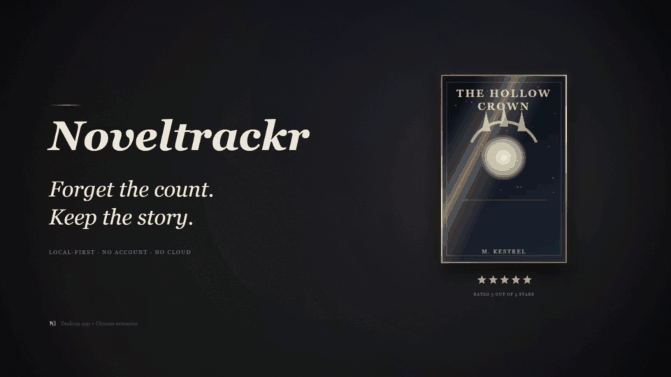
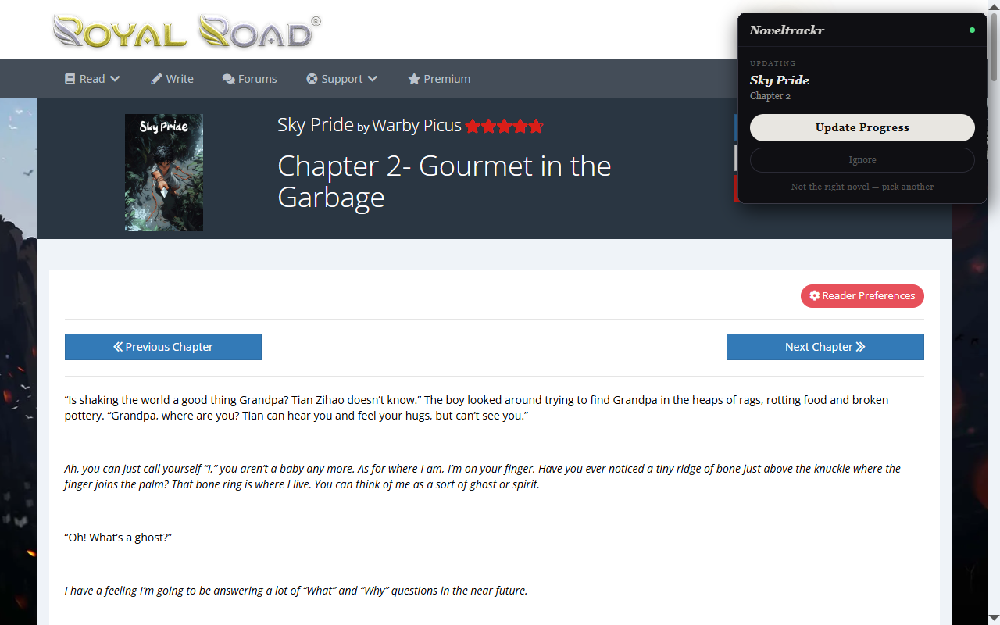
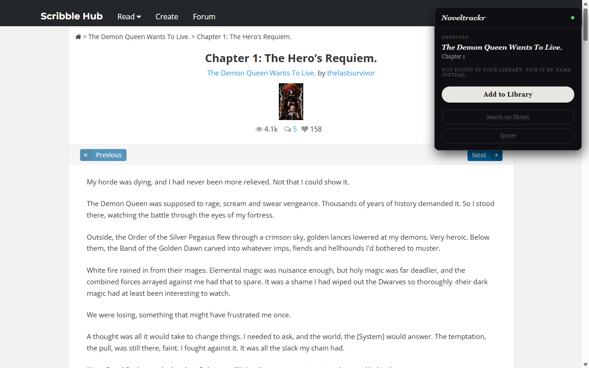
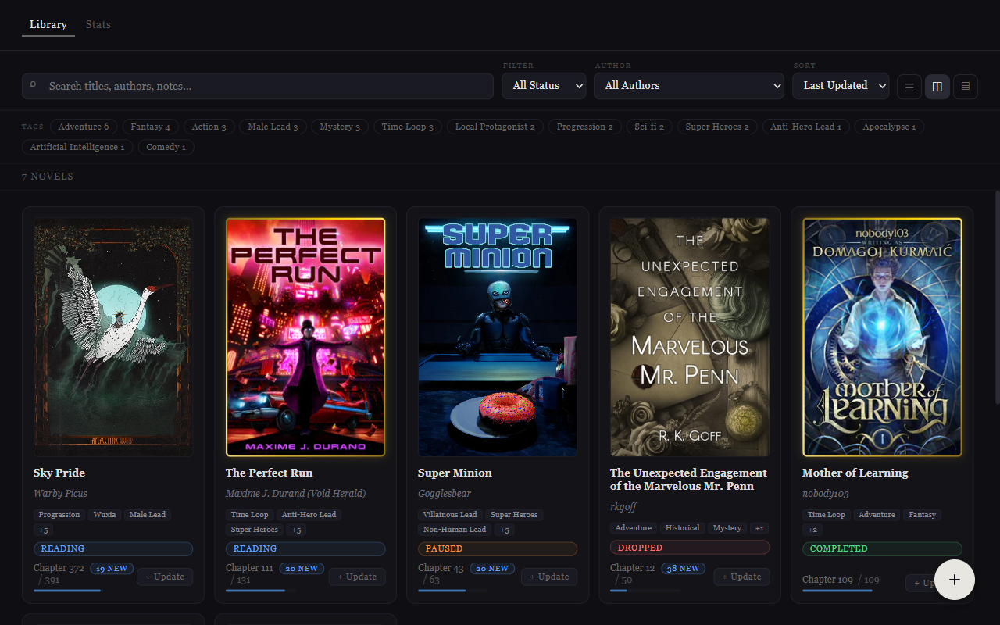
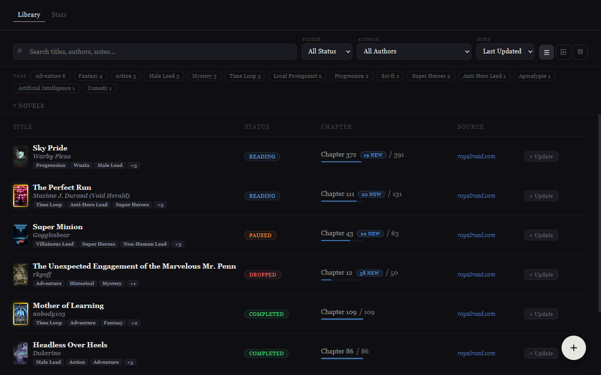
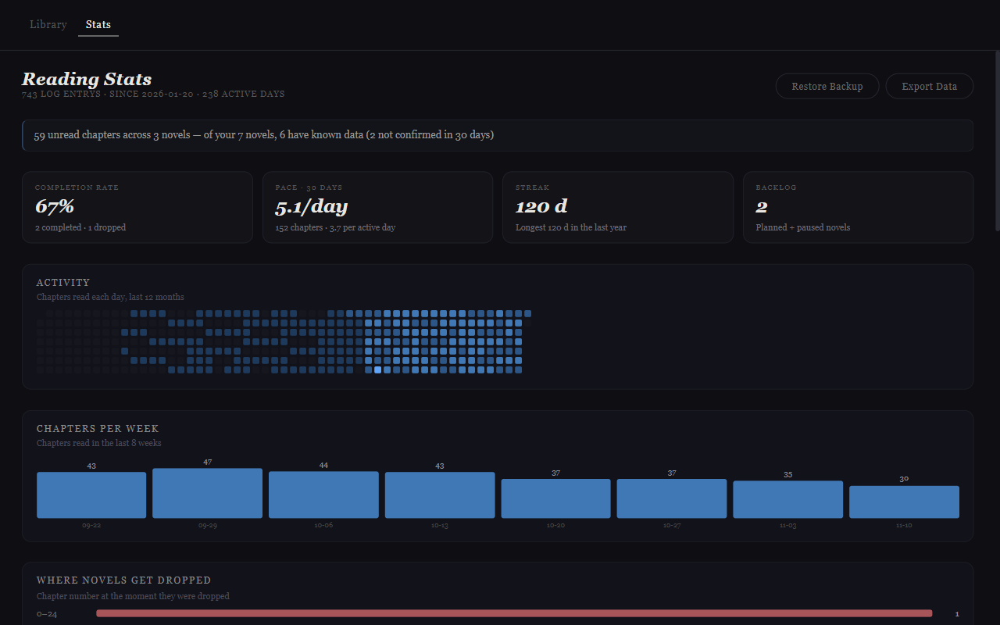

# Noveltrackr

**Stop updating your reading list by hand. Noveltrackr watches where you read and updates your progress automatically.**

A local-first desktop library for web novels, light novels and manhwa — paired with a Chrome extension that notices the chapter you are on and files it for you.

- **Automatic progress detection** — while you read, the extension works out the novel and chapter from the page and saves them with one click.
- **Stats and a reading log** — every chapter and status change is recorded locally and turned into pace, streaks, completion, drop reasons and a year-long heatmap.
- **Local-first** — no account, no cloud, no telemetry. One SQLite file on your disk.

## Install

1. **Install the desktop app.** Download the Windows installer from [the latest release](https://github.com/R1ku1/NovelTrackr/releases/latest) and run it.
2. **Add the Chrome extension.** Download `extension.zip` from the same release, extract it, then open `chrome://extensions`, enable **Developer mode**, click **Load unpacked**, and select the extracted folder. *(A Chrome Web Store listing is not available yet.)*
3. **Leave the app running.** Closing the window keeps Noveltrackr in the system tray.

**The desktop app must be running for the extension to save progress.**

## Supported sites

| Site | What Noveltrackr reads |
| --- | --- |
| [Royal Road](https://www.royalroad.com) | Chapter, title, author, tags, cover, chapter count |
| [ScribbleHub](https://www.scribblehub.com) | Chapter, title, author, tags, cover, chapter count |
| [NovelFire](https://novelfire.net) | Chapter, title, author, tags, cover, chapter count |
| [NovelUpdates](https://www.novelupdates.com) | Series search and pick-list, tag names, newest-release offer (not a reading site) |
| Other reading sites | Title and chapter from the page; author when the page exposes one |

## Features

- **Automatic chapter tracking** — one click in the popup; a confirmed title-to-novel mapping makes later chapters on that page report themselves. Unrecognised novels can be added from the same popup, or matched with a library search when the page title is ambiguous.
- **Library views** — list, grid and compact, with search across titles, aliases, authors and notes, plus filters for status, tag and author.
- **Statuses and progress** — Reading, Planned, Paused, Completed and Dropped; quick chapter updates; `N new` badges and progress bars built from the site's own chapter count.
- **Reading log** — every status change and chapter update is recorded permanently, with each novel's own history and 30-day total.
- **Stats** — completion rate, reading pace, streaks, drop points and reasons, a year-long activity heatmap, per-tag insights, where you read, current reads and backlog age.
- **Ratings and drop reasons** — rate novels 1–5 and record why you dropped one; both feed the stats.
- **Tags and metadata** — author and tags captured from the page, aliases, NovelUpdates tag suggestions, and a "Find on NU" series picker.
- **Covers** — load a cover from a URL or capture one from the site; five-star novels get a foil-stamped cover.
- **Backups and export** — JSON export and restore in one transaction, plus daily and pre-restore snapshots.
- **Tray-first** — close the window and keep the app running; no account, no cloud, no telemetry.

The long version — progress lower bounds, address matching, popup offers, NovelUpdates handling and the foil stamp — is in [docs/technical-notes.md](docs/technical-notes.md).

## Screenshots

*App views use a sample library; the popup screenshots are the live extension on Royal Road and ScribbleHub.*

### Extension popup — Royal Road

### Extension popup — ScribbleHub

### Library

### Stats

## Data and privacy

- **Database:** `%APPDATA%\com.aweso.noveltrackr\noveltrackr.db`
- **Backups:** `%APPDATA%\com.aweso.noveltrackr\backups\` — the last 7 daily snapshots plus the 5 most recent taken before a restore. Restore any of them with **Restore Backup** on the stats page, or open them with any SQLite viewer.
- **Export:** the full library exports to JSON and restores in one transaction, so a bad file changes nothing.
- **No telemetry, no account, no cloud.** The extension only talks to the app at `127.0.0.1:39172`, and chapter data is saved only from pages you visit — nothing is fetched in the background. NovelUpdates searches are run by you, in your browser.
- **Full policy:** [privacy.md](privacy.md) — what the extension reads, where it is stored, and how to delete it.

## Known limitations

- **Windows only** for now.
- **Unsigned installer.** SmartScreen may warn on first run: click **More info → Run anyway**.
- **Chrome/Chromium only** for the extension, and it is not on the Chrome Web Store yet.
- **Visited pages only.** Progress updates when you visit a chapter page; a novel you have never browsed shows no "new" badge rather than "0 new".
- **Site changes.** A change to a site's markup can pause detection until the selectors are updated.

## Contributing, feedback and license

- Found a bug or want a feature? [Open an issue](https://github.com/R1ku1/NovelTrackr/issues).
- PRs are welcome — keep them focused and matching the existing style. Before opening one, run `npm install && npm run build`, `node extension/selfcheck.mjs`, and for desktop changes `npm run tauri dev`.
- Built with Tauri 2, React, TypeScript and SQLite.
- Licensed under the [MIT License](LICENSE). Use it, fork it, ship it.
